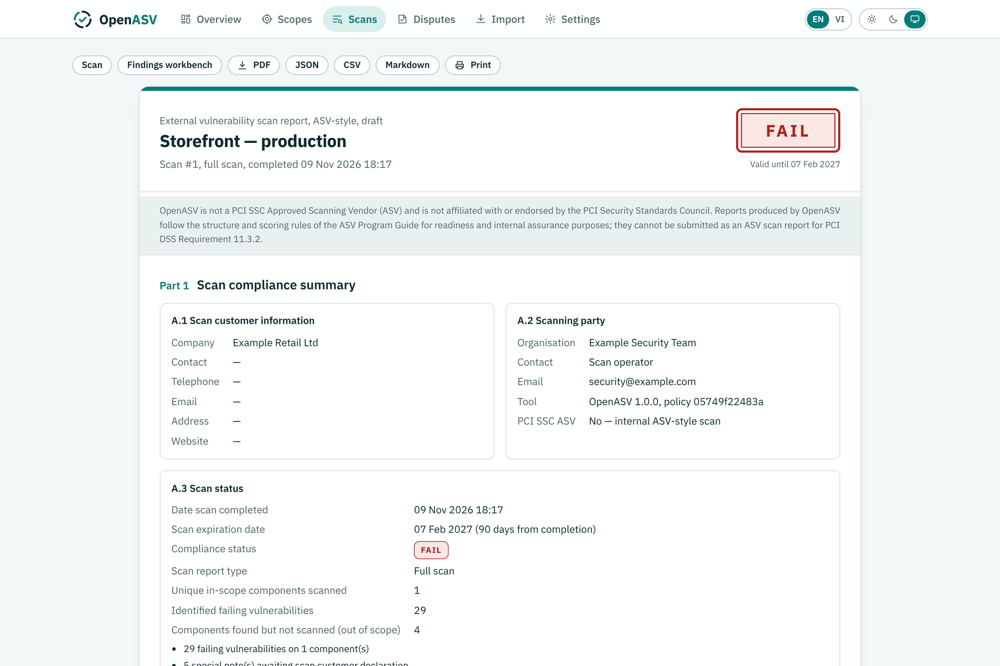
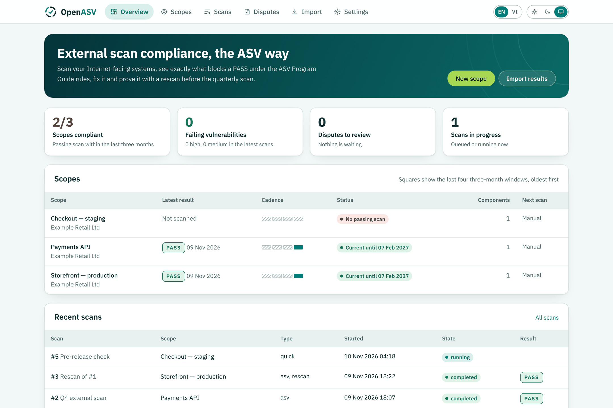
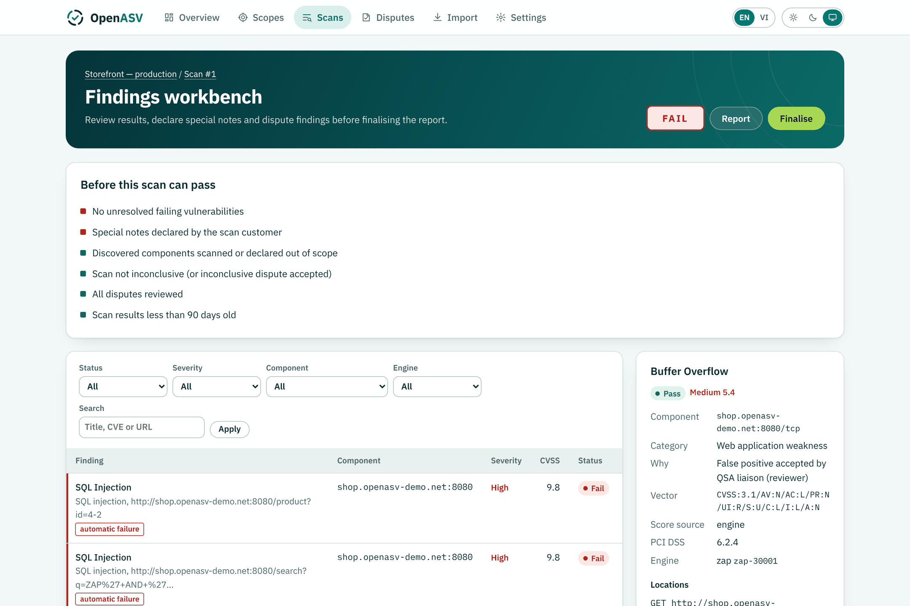
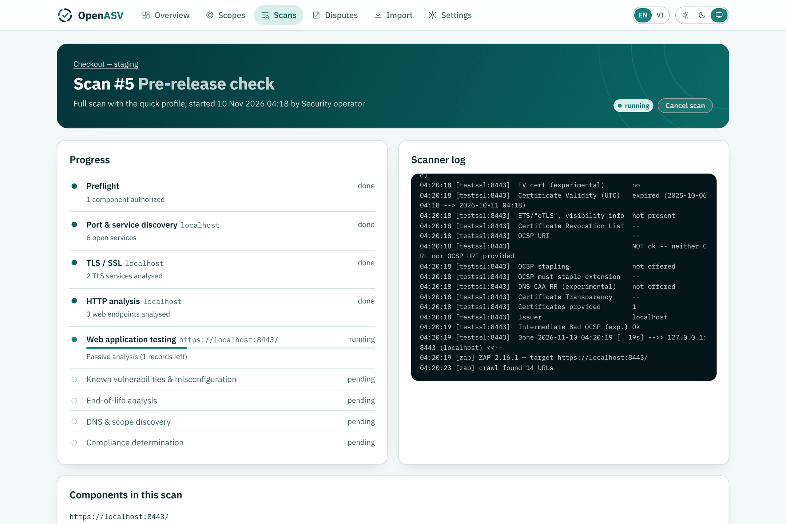
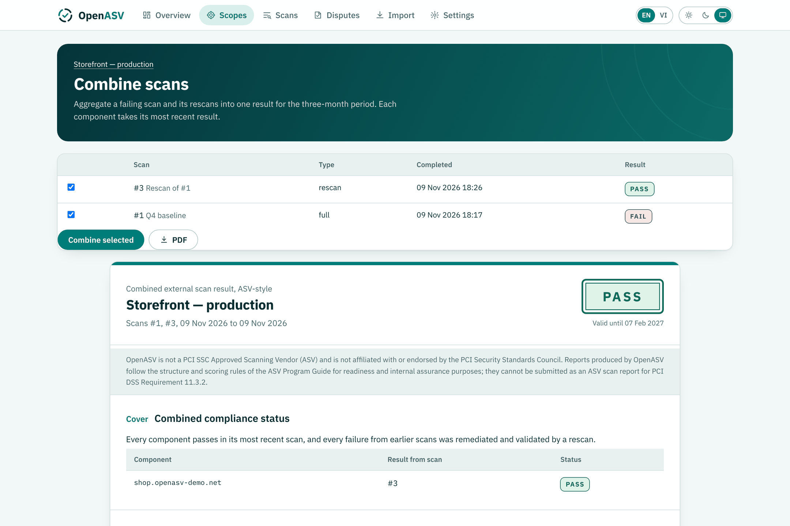
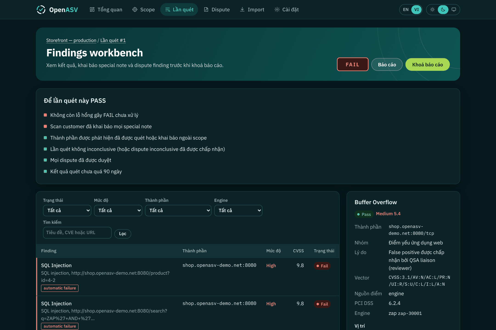
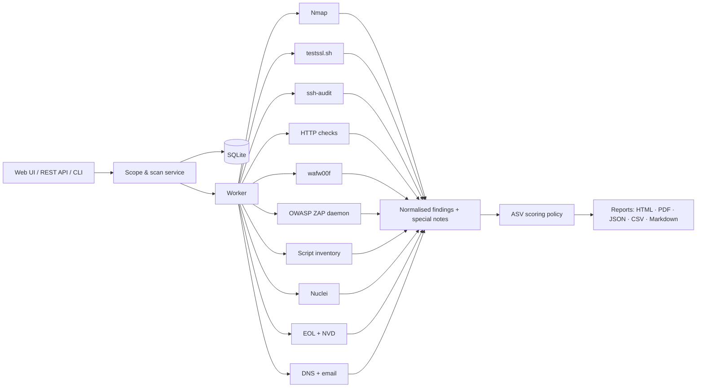

<p align="center">
  
</p>
<h1 align="center">OpenASV</h1>
<p align="center">
  <b>Open-source external vulnerability scanning with ASV-style PCI DSS compliance reporting.</b><br>
  Scan your Internet-facing components the way an Approved Scanning Vendor does, see exactly what blocks a passing result, and fix it before the quarterly scan.
</p>
<p align="center">
  <a href="https://github.com/Deja-Vyx/openasv/actions/workflows/ci.yml"></a>
  <a href="LICENSE"></a>
  
  
</p>
<p align="center"><b>English</b> · <a href="README.vi.md">Tiếng Việt</a></p>



> [!IMPORTANT]
> OpenASV is **not** a PCI SSC Approved Scanning Vendor and is not affiliated with the PCI Security Standards Council.
> It reproduces the scanning coverage, scoring rules and report structure of the
> [ASV Program Guide](https://www.pcisecuritystandards.org/) so you can find and fix failures before your official
> scan, run scans between quarters, and scan environments an ASV cannot reach (pre-production, internal staging).
> Its reports cannot be submitted to satisfy PCI DSS Requirement 11.3.2. (Also not to be confused with OpenVAS, the
> Greenbone scanner, whose reports OpenASV can import.)

## Contents

- [What OpenASV does](#what-openasv-does)
- [Quick start with Docker](#quick-start-with-docker)
- [Run from PyCharm or any IDE](#run-from-pycharm-or-any-ide)
- [Your first scan](#your-first-scan)
- [How results are scored](#how-results-are-scored)
- [Scope of testing and PCI DSS coverage](#scope-of-testing-and-pci-dss-coverage)
- [CLI and CI pipelines](#cli-and-ci-pipelines)
- [Import results from Nessus, OpenVAS and others](#import-results-from-nessus-openvas-and-others)
- [REST API](#rest-api)
- [Configuration](#configuration)
- [Architecture](#architecture)
- [Responsible use](#responsible-use)
- [Roadmap](#roadmap) · [Contributing](#contributing) · [License](#license)

## What OpenASV does

OpenASV orchestrates proven open-source scanners, normalises their output, and applies the ASV compliance rules on top.

| ASV scan activity | OpenASV |
|---|---|
| Scope definition by the scan customer | Scopes with IPs, hostnames, CIDR ranges and web application URLs; scan customer details (report section A.1) |
| Discovery of additional components (DNS, MX, redirects, crawling) | DNS discovery of MX, NS and common hostnames, certificate SANs, redirects and crawled links; each must be **added to scope or declared out of scope** |
| Service discovery on all TCP and common UDP ports | Nmap: all 65,535 TCP ports, common UDP ports, version and OS detection |
| SSL/TLS testing | testssl.sh: protocols, cipher suites, certificate trust, expiry and hostname match, TLS vulnerabilities |
| Web application testing | OWASP ZAP: crawl, passive analysis and active testing (SQL injection, XSS, traversal, header injection and more) |
| Known vulnerabilities, default accounts, backdoors | Nuclei templates; version-based CVE correlation through the NVD API |
| Unsupported operating systems and software | End-of-life detection from banners and OS fingerprints (endoflife.date data, bundled offline) |
| DNS zone transfer | AXFR test against authoritative and in-scope name servers |
| Remote access services | ssh-audit: SSH protocol version, key exchange, host keys, ciphers and MACs |
| Web application protection | wafw00f: fingerprint of a web application firewall in front of each web application |
| Payment page scripts and headers | Script inventory, Subresource Integrity and security headers per page; differences since the previous scan |
| Changes between scans | Services, scripts and headers that changed since the previous scan of the scope |
| Email spoofing exposure | SPF and DMARC policy of in-scope domains that receive mail |
| CVSS scoring and automatic failures | Fail at CVSS ≥ 4.0; automatic failures regardless of score; denial-of-service exemption |
| Special notes and customer declarations | Remote access, insecure services, unknown services, directory browsing, anonymous ciphers, POS software, embedded out-of-scope content, load balancers |
| Scan interference / inconclusive scans | Liveness monitoring during the scan and WAF-block detection; inconclusive scans fail until disputed |
| Disputes: false positives, compensating controls, exceptions, CVSS | Per-finding disputes with system-generated evidence uploads, customer attestation and reviewer decision; never carried forward automatically |
| Rescans and combined reports | Rescan failing components only, then combine scans into one result for the three-month period |
| Report with attestation, summary and details | HTML, PDF, JSON, CSV and Markdown in the ASV layout, with PCI DSS v4.0.1 requirement mapping |
| Quarterly cadence | Three-month cadence tracking, monthly or 90-day schedules, webhook notifications |

Plus: findings workbench with filters, REST API, CI-friendly CLI with exit codes, import of Nessus / OpenVAS / ZAP / Nuclei / Nmap / testssl.sh results, audit trail, optional sign-in, an English and Vietnamese interface, light and dark themes, and masking of anything that looks like a card number so the scanner never stores cardholder data.

<table>
<tr>
<td></td>
<td></td>
</tr>
<tr>
<td align="center">Compliance overview with three-month cadence</td>
<td align="center">Findings workbench: evidence, disputes, declarations</td>
</tr>
<tr>
<td></td>
<td></td>
</tr>
<tr>
<td align="center">Live progress per engine and component</td>
<td align="center">Failing scan plus rescan combined into one result</td>
</tr>
<tr>
<td colspan="2"></td>
</tr>
<tr>
<td colspan="2" align="center">Dark theme, Vietnamese interface</td>
</tr>
</table>

## Quick start with Docker

Requirements: Docker with Compose, about 5 GB of disk and 4 GB of memory for Docker (OWASP ZAP is the heaviest part).

```bash
git clone https://github.com/Deja-Vyx/openasv.git
cd openasv
cp .env.example .env            # set ZAP_API_KEY and, if others can reach the host, OPENASV_ADMIN_PASSWORD
docker compose up -d --build
```

Open <http://localhost:9100>. The first build downloads the ZAP image, Nmap, testssl.sh, Nuclei and its templates.

### Try it on the bundled demo target

```bash
docker compose --profile demo up -d --build
```

Create a scope with the component `https://demo-target:8443/` and run an **ASV Standard** scan. The demo target is
deliberately vulnerable: expect a **FAIL** with SQL injection, XSS, TLS 1.0, an expired certificate, an exposed MySQL
service, end-of-life software, a cleartext login form and several special notes. Switch it to the fixed version and
scan again:

```bash
DEMO_MODE=strong docker compose --profile demo up -d demo-target
```

## Run from PyCharm or any IDE

OpenASV is a plain Python package (Flask + SQLite), so it runs from source on Linux, macOS and Windows with Python 3.10+.

1. **Open the folder** in PyCharm (*File → Open*) and let it create a virtual environment from `requirements.txt`,
   or do it yourself:

   ```bash
   python -m venv .venv
   source .venv/bin/activate          # Windows: .venv\Scripts\activate
   pip install -r requirements-dev.txt
   ```

2. **Run it.** The repository ships shared run configurations in `.run/`, so PyCharm shows **OpenASV server**,
   **OpenASV doctor** and **Tests** in the run menu. From a terminal the equivalent is:

   ```bash
   python -m openasv            # web UI on http://127.0.0.1:9100
   python -m openasv doctor     # lists the engines that were found
   ```

   Settings are read from a `.env` file in the project folder (copy `.env.example`), so no run-configuration
   environment is needed.

3. **Add the scan engines.** The interface, imports, scoring, reports and tests work without them; live scans need:

   | Engine | Easiest way |
   |---|---|
   | OWASP ZAP | `docker compose -f docker-compose.dev.yml up -d` (API on `127.0.0.1:8090`, the default OpenASV looks for), or a local ZAP started with `-daemon -port 8090 -config api.key=change-me` |
   | Nmap | Package manager or [nmap.org](https://nmap.org/download) installer; must be on `PATH` (or set `OPENASV_NMAP`) |
   | testssl.sh | `git clone --depth 1 https://github.com/testssl/testssl.sh` and set `OPENASV_TESTSSL=/path/to/testssl.sh`; on Windows it needs Git Bash or WSL |
   | Nuclei | [Release binary](https://github.com/projectdiscovery/nuclei/releases) on `PATH` (or set `OPENASV_NUCLEI`) |
   | ssh-audit, wafw00f | `pip install ssh-audit wafw00f` (optional; a missing one is listed under report limitations) |

   An engine that is missing is reported in the scan as *did not complete*, which makes that scan inconclusive
   instead of silently passing. On Windows the simplest full setup is the Docker one above; running from the IDE is
   best for development, imports and reporting.

PDF export uses WeasyPrint, which needs the Pango libraries (see the WeasyPrint install notes for Windows and macOS).
Everything else works without it; remove the `weasyprint` line from `requirements.txt` if it does not install.

## Your first scan

1. **Create a scope** and list every external IP address, hostname and web application URL of the environment, including URLs that cannot be reached by crawling from the home page.
2. **Run scan** with the *ASV Standard* profile. Confirm you are authorized to test the components. Ask your network team to set IPS and rate-based WAF rules to log rather than block during the scan window.
3. **Review findings** in the workbench. Each failing finding shows why it fails, its CVSS vector and source, the evidence, remediation and the PCI DSS requirements it relates to.
4. **Declare special notes** (for example, why SSH is exposed and how it is protected) and **decide on discovered components** (add to scope or declare out of scope with the reason it is segmented).
5. **Fix or dispute** each failure. Disputes need a justification, system-generated evidence and the customer's attestation; a reviewer accepts or rejects them.
6. **Rescan failing components**, then **combine** the original scan and the rescan into one result for the period.
7. **Finalise** the report: the scan customer attests to scope and evidence, the reviewer is recorded, and the report is locked.

## How results are scored

OpenASV implements the compliance-determination rules of the ASV Program Guide in [`config/policy.yaml`](config/policy.yaml):

- A component **fails** when it has a vulnerability with a CVSS base score of **4.0 or higher**. Severity bands: Low 0.0–3.9, Medium 4.0–6.9, High 7.0–10.0.
- **Automatic failures** regardless of score: SQL injection, cross-site scripting, directory traversal, HTTP response splitting / header injection, default or built-in accounts, unsupported operating systems or software, Internet-reachable databases, backdoors and malware, unrestricted DNS zone transfers, and SSL or early TLS.
- **Purely denial-of-service** vulnerabilities are not ranked as failures.
- **Special notes** do not change scoring, but the scan is reported as FAILED until the scan customer declares each one.
- **Discovered components** must be scanned or declared out of scope.
- **Inconclusive** scans (engine failure or suspected active blocking) are reported as failed until an inconclusive-scan dispute is accepted.
- A **rescan** covers only the components that failed, so it counts towards the three-month cadence only when combined with the scan it re-tests.
- CVSS precedence: score from NVD or the engine → vector assigned by the policy for the finding category → vector derived from the engine's risk rating. The source is shown on every finding.

Failing web findings are kept one per URL and parameter so each can be disputed individually, as ASVs require; passing findings of the same rule are grouped to keep reports readable.

## Scope of testing and PCI DSS coverage

> **OpenASV is a black-box scanner, by design.** Like an ASV scan under PCI DSS Requirement 11.3.2, it tests only what
> is reachable from the Internet, without credentials, source code or access to the internal network. Every check
> added to OpenASV must keep that property. Internal vulnerability scans (11.3.1), authenticated configuration
> reviews, code review, searches for stored cardholder data, segmentation tests and penetration tests (11.4) are
> different activities and are intentionally out of scope.

An external scan can **decide** very few requirements on its own, but it produces technical evidence for many more.
OpenASV maps each finding to PCI DSS v4.0.1 with one of two relations: **direct** (the finding is technical evidence
for the requirement) or **related** (the finding informs the requirement, which still needs other evidence).

| Requirement | What OpenASV observes from outside | Relation |
|---|---|---|
| 1.2.5, 2.2.4 | Every service reachable from the Internet; services that appeared or disappeared since the previous scan | related |
| 1.2.6, 2.2.5 | Insecure services and protocols in use (SSL / early TLS, logins over cleartext HTTP) | related |
| 1.4.2 | Database listeners reachable from the Internet | direct |
| 2.2.2 | Default or built-in accounts that accept a login | direct |
| 2.2.6 | Zone transfers, directory listings, exposed configuration files, unnecessary HTTP methods | related |
| 2.2.7 | Broken SSH cryptography; administrative interfaces over weak TLS or cleartext | direct / related |
| 3.4.1 | Full PAN returned in an HTTP response | direct |
| 4.2.1 | Protocol versions, cipher suites, certificate trust, expiry and hostname match | direct |
| 4.2.1.1, 12.3.3 | Inventory of certificates, TLS protocols and SSH algorithms in use | related |
| 5.2.1, 12.10.1 | Backdoors, web shells or malware indicators | related |
| 5.4.1 | SPF and DMARC policy of in-scope mail domains (anti-spoofing) | related |
| 6.2.4 | SQL injection, cross-site scripting, directory traversal, header injection | direct |
| 6.3.1, 6.3.3 | Known CVEs, vulnerable or unpatched versions | direct / related |
| 6.3.2 | Third-party JavaScript libraries with known vulnerabilities | related |
| 6.4.1, 6.4.2 | Whether a web application firewall can be fingerprinted in front of each web application | related |
| 6.4.3 | Script inventory of sampled pages; external scripts without Subresource Integrity on payment pages | direct / related |
| 8.3.2 | Password forms served over cleartext HTTP; broken SSH cryptography | direct / related |
| 8.3.4, 8.4.2 | Login forms reachable from the Internet (a pointer to verify lockout and MFA; not tested) | related |
| 11.3.2 | The scan itself, the ASV scoring rules, rescans and the three-month cadence | direct |
| 11.3.2.1 | Changes in exposed services that call for a scan after a significant change | related |
| 11.6.1 | Scripts and security headers that changed since the previous scan | related |
| 12.3.4 | Operating systems and software past end of life | direct |

What a black-box scan cannot tell you, and OpenASV does not claim: whether policies and procedures exist
(Requirements 7, 9 and 12 in general), how data is stored (Requirement 3), what is logged (Requirement 10), whether MFA
and lockout are actually enforced (Requirement 8), or anything about systems that are not reachable from the Internet.
Informational records (inventories, change evidence, WAF detection, login forms) are never scored: they do not
change PASS or FAIL.

The mapping lives in [`config/policy.yaml`](config/policy.yaml) and the requirement titles in
[`config/pci-dss.yaml`](config/pci-dss.yaml); the titles are short paraphrases, so always read the official standard.

## CLI and CI pipelines

```bash
openasv scan https://staging.example.com/ --profile quick -f md -o openasv.md --i-am-authorized
echo $?     # 0 PASS, 2 FAIL, 3 scan error
```

GitHub Actions example (self-hosted runner that can reach the staging environment, with the engines installed or the OpenASV image):

```yaml
- name: External scan (ASV-style)
  run: |
    openasv scan "$STAGING_URL" --profile quick -f md -o openasv.md --i-am-authorized || status=$?
    cat openasv.md >> "$GITHUB_STEP_SUMMARY"
    exit ${status:-0}
```

Other commands: `openasv import`, `openasv report <id> -f pdf -o report.pdf`, `openasv doctor`, `openasv eol-update`.

## Import results from Nessus, OpenVAS and others

Already scanning with another tool? Import its export to get ASV-style scoring, special notes, disputes and PCI DSS mapping:

| Source | Export |
|---|---|
| Tenable Nessus (including Essentials) | `.nessus` (v2) |
| Greenbone / OpenVAS | XML report |
| OWASP ZAP | Traditional JSON report |
| Nuclei | `-jsonl` |
| Nmap | `-oX` |
| testssl.sh | `--jsonfile` |

Use **Import results** in the UI, `openasv import scan.nessus --scope "Store"` or `POST /api/v1/import`.

## REST API

Set `OPENASV_API_TOKEN` and send `Authorization: Bearer <token>`.

| Method | Path | Purpose |
|---|---|---|
| GET | `/api/v1/scopes` | Scopes, components and cadence status |
| POST | `/api/v1/scopes` | Create a scope `{"name": "...", "components": ["https://..."]}` |
| POST | `/api/v1/scopes/{id}/scans` | Launch a scan `{"profile": "asv", "authorized": true}` |
| GET | `/api/v1/scans/{id}` | Scan state and result |
| GET | `/api/v1/scans/{id}/report` | Full report as JSON |
| POST | `/api/v1/import` | Multipart upload: `file`, `scope_id`, optional `format` |

See [docs/api.md](docs/api.md) for request and response examples.

## Configuration

| File | Purpose |
|---|---|
| [`config/target-policy.yaml`](config/target-policy.yaml) | Which targets may be scanned. Private networks are allowed by default; public hosts and ranges must be listed explicitly. |
| [`config/policy.yaml`](config/policy.yaml) | Scoring policy: categories, CVSS vectors, automatic failures, special notes, classification of engine rules. |
| [`config/profiles.yaml`](config/profiles.yaml) | Scan profiles: ASV Standard, Quick, Web application. |
| [`config/pci-dss.yaml`](config/pci-dss.yaml) | PCI DSS v4.0.1 requirements referenced by findings; add testing procedures if you need them in reports. |
| `config/nuclei/*.yaml` | Your own Nuclei templates, run with every scan. |

| Environment variable | Default | Meaning |
|---|---|---|
| `OPENASV_ADMIN_PASSWORD` | unset | Require sign-in for the UI |
| `OPENASV_API_TOKEN` | unset | Enable the REST API |
| `OPENASV_ZAP_API`, `OPENASV_ZAP_API_KEY` | `http://127.0.0.1:8090` (`http://zap:8080` in Docker) | ZAP daemon |
| `OPENASV_PRIVILEGED` | `1` in Docker | SYN, UDP and OS detection (needs `NET_RAW`) |
| `OPENASV_NVD`, `OPENASV_NVD_API_KEY` | on, no key | Version-based CVE correlation |
| `OPENASV_NUCLEI_INTERACTSH` | off | Out-of-band testing through interactsh |
| `OPENASV_EXTRA_CA` | `/certs/ca.crt` | Extra trusted CAs for TLS checks (comma-separated) |
| `OPENASV_LOCALHOST_ALIAS` | `host.docker.internal` | Name used when you scan `localhost` from the container |
| `OPENASV_WEBHOOK_URL` | unset | Slack, Teams or generic JSON webhook when a scan completes |
| `OPENASV_SCANNER_COMPANY`, `_CONTACT`, `_EMAIL`, `_WEBSITE` | unset | Scanning party shown in report section A.2 |
| `OPENASV_DATA_DIR`, `OPENASV_CONFIG_DIR` | `./data`, `./config` (`/data`, `/app/config` in Docker) | Storage and configuration paths |
| `OPENASV_LANG` | `en` | Language of reports exported from the CLI (`en` or `vi`) |

### Language and theme

The interface and reports are available in **English** (default) and **Vietnamese**; switch with the EN / VI control in
the top bar. The choice is stored in a cookie per browser, so exports follow the language you are viewing. Findings
reported by the engines (titles, descriptions, evidence) stay in the engine's language. The theme control offers
light, dark and match-the-system.

To add a language, copy [`openasv/i18n/vi.json`](openasv/i18n/vi.json), translate the values and register the code in
`openasv/i18n/__init__.py`. Templates are written in plain English and wrapped automatically; a test fails when a
template string has no translation.

## Architecture



Each engine writes its raw output to the scan folder; parsers turn it into normalised findings, which are classified (rule → CWE → keyword), scored and mapped to PCI DSS. One engine failing never hides the others' results; it marks the scan inconclusive instead.

## Responsible use

- Only scan systems you own or have **written authorization** to test. OpenASV enforces a target policy and asks for confirmation on every scan, and records who confirmed it.
- Active testing sends attack payloads (SQL injection, XSS) and can create data in applications. Schedule scans with the system owner.
- Expose the UI only on trusted networks, and set `OPENASV_ADMIN_PASSWORD` and `OPENASV_API_TOKEN` when anyone else can reach it.
- Report security issues in OpenASV itself as described in [SECURITY.md](SECURITY.md).

## Roadmap

- Greenbone/OpenVAS as a live scan engine (GMP), in addition to importing its reports
- Authenticated web scanning profiles for internal scans (Requirement 11.3.1)
- Multi-user roles: scan customer, reviewer, administrator
- SARIF and JUnit exports for code-scanning dashboards
- More interface languages

Ideas and pull requests are welcome; see [CONTRIBUTING.md](CONTRIBUTING.md).

## Contributing

```bash
pip install -e ".[dev,pdf]"
pytest            # unit and web tests
ruff check .
```

Policy changes (new categories, special-note rules, classification of engine rules) are among the most valuable contributions; please include the ASV Program Guide section or vendor documentation that supports them.

## License

Apache License 2.0. See [LICENSE](LICENSE) and [NOTICE](NOTICE) for bundled fonts and data.

OpenASV stands on the shoulders of [Nmap](https://nmap.org), [testssl.sh](https://testssl.sh), [OWASP ZAP](https://www.zaproxy.org),
[Nuclei](https://github.com/projectdiscovery/nuclei), [endoflife.date](https://endoflife.date) and the
[NVD](https://nvd.nist.gov). "PCI DSS" and "Approved Scanning Vendor" are terms of PCI Security Standards Council, LLC; OpenASV is an independent
open-source project.
