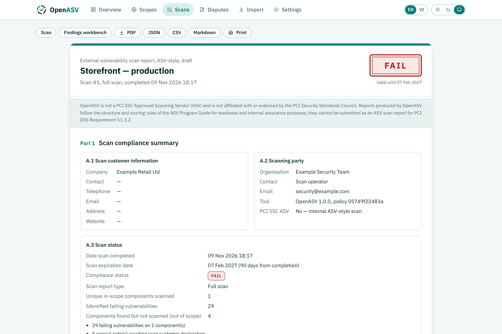
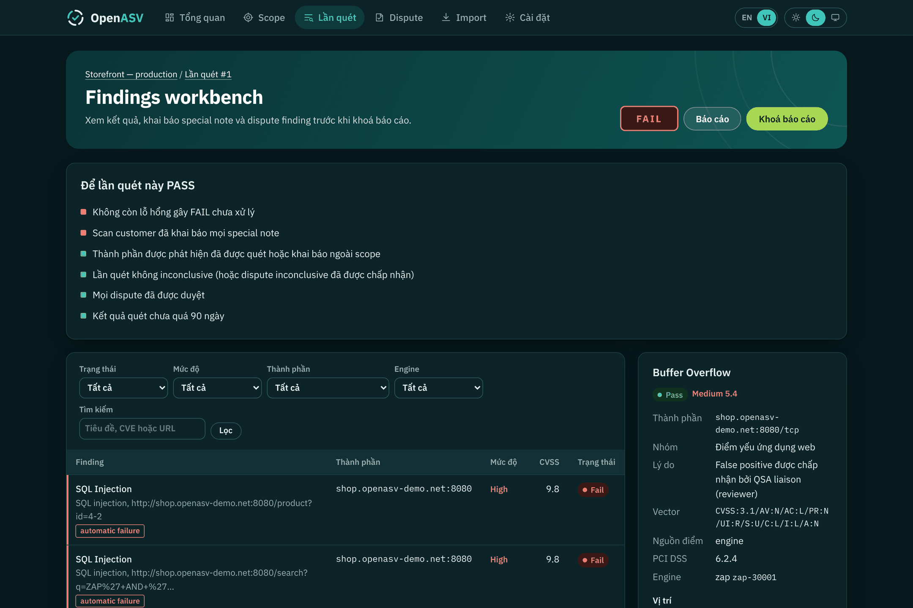

<p align="center"></p>
<h1 align="center">OpenASV</h1>
<p align="center">
  <b>Quét lỗ hổng từ bên ngoài (external vulnerability scan) mã nguồn mở, báo cáo tuân thủ PCI DSS theo chuẩn ASV.</b><br>
  Quét các thành phần hướng Internet theo cách một Approved Scanning Vendor làm, biết chính xác điều gì đang chặn kết quả PASS, và khắc phục trước kỳ quét quý.
</p>
<p align="center"><a href="README.md">English</a> · <b>Tiếng Việt</b></p>



> [!IMPORTANT]
> OpenASV **không phải** là Approved Scanning Vendor (ASV) được PCI SSC công nhận và không liên kết với PCI Security Standards Council.
> Công cụ tái hiện phạm vi quét, quy tắc chấm điểm và cấu trúc báo cáo của ASV Program Guide để bạn tìm và sửa lỗi trước
> kỳ quét chính thức, quét giữa các quý, và quét những môi trường ASV không truy cập được (pre-production, staging nội bộ).
> Báo cáo của OpenASV không thể nộp thay cho báo cáo ASV theo Requirement 11.3.2. (Cũng đừng nhầm với OpenVAS, scanner của
> Greenbone; OpenASV import được báo cáo của OpenVAS.)

## OpenASV làm được gì

| Hoạt động của một lần quét ASV | OpenASV |
|---|---|
| Khách hàng khai báo phạm vi (scope) | Scope gồm IP, hostname, dải CIDR và URL ứng dụng web; thông tin khách hàng (mục A.1 của báo cáo) |
| Phát hiện thành phần bổ sung (DNS, MX, redirect, crawl) | Tìm MX, NS, hostname phổ biến, SAN trong chứng chỉ, redirect và liên kết khi crawl; mỗi thành phần phải được **đưa vào scope hoặc khai báo ngoài scope** |
| Quét toàn bộ cổng TCP và các cổng UDP phổ biến | Nmap: 65.535 cổng TCP, UDP phổ biến, nhận diện phiên bản và hệ điều hành |
| Kiểm tra SSL/TLS | testssl.sh: giao thức, cipher suite, độ tin cậy, hạn và tên miền của chứng chỉ, lỗ hổng TLS |
| Kiểm tra ứng dụng web | OWASP ZAP: crawl, phân tích passive, active scan (SQL injection, XSS, directory traversal, header injection…) |
| Lỗ hổng đã biết, tài khoản mặc định, backdoor | Template Nuclei; đối chiếu CVE theo phiên bản qua NVD API |
| Hệ điều hành / phần mềm hết hỗ trợ | Phát hiện end-of-life từ banner và fingerprint OS (dữ liệu endoflife.date, đóng gói sẵn offline) |
| DNS zone transfer | Thử AXFR với name server có thẩm quyền và name server trong scope |
| Dịch vụ remote access | ssh-audit: phiên bản giao thức SSH, key exchange, host key, cipher và MAC |
| Bảo vệ ứng dụng web | wafw00f: nhận diện web application firewall đứng trước từng ứng dụng web |
| Script và header của trang thanh toán | Kiểm kê script, Subresource Integrity và security header theo trang; khác biệt so với lần quét trước |
| Thay đổi giữa các lần quét | Dịch vụ, script và header thay đổi so với lần quét trước của scope |
| Nguy cơ giả mạo email | Chính sách SPF và DMARC của domain trong scope có nhận mail |
| Chấm điểm CVSS và automatic failure | FAIL khi CVSS ≥ 4.0; automatic failure bất kể điểm; ngoại lệ cho lỗ hổng chỉ gây DoS |
| Special notes và khai báo của khách hàng | Remote access, dịch vụ không an toàn, dịch vụ không xác định, directory browsing, cipher ẩn danh, phần mềm POS, nội dung nhúng từ domain ngoài scope, load balancer |
| Can thiệp vào lần quét / quét không kết luận được | Theo dõi khả năng phản hồi của mục tiêu và phát hiện WAF chặn; lần quét inconclusive bị FAIL cho tới khi dispute được chấp nhận |
| Dispute: false positive, compensating control, exception, CVSS | Dispute theo từng finding, kèm bằng chứng do hệ thống tạo, cam kết của khách hàng và quyết định của reviewer; không tự động chuyển sang kỳ sau |
| Quét lại và gộp báo cáo | Quét lại riêng các thành phần FAIL, rồi gộp nhiều lần quét thành một kết quả cho kỳ ba tháng |
| Báo cáo gồm attestation, tóm tắt và chi tiết | HTML, PDF, JSON, CSV và Markdown theo bố cục ASV, kèm ánh xạ requirement PCI DSS v4.0.1 |
| Chu kỳ quét theo quý | Theo dõi nhịp ba tháng, lịch quét 30 hoặc 90 ngày, thông báo qua webhook |

Ngoài ra: findings workbench có bộ lọc, REST API, CLI cho pipeline CI (exit code theo kết quả), import kết quả từ Nessus / OpenVAS / ZAP / Nuclei / Nmap / testssl.sh, audit trail, đăng nhập tuỳ chọn, giao diện tiếng Anh và tiếng Việt, theme sáng và tối, và tự động che mọi chuỗi giống số thẻ để công cụ không bao giờ lưu dữ liệu chủ thẻ.



## Bắt đầu nhanh với Docker

Cần Docker kèm Compose, khoảng 5 GB đĩa trống và 4 GB RAM cho Docker (OWASP ZAP nặng nhất).

```bash
git clone https://github.com/Deja-Vyx/Open-ASV.git
cd openasv
cp .env.example .env            # đặt ZAP_API_KEY; đặt OPENASV_ADMIN_PASSWORD nếu người khác truy cập được máy
docker compose up -d --build
```

Mở <http://localhost:9100>. Lần build đầu tiên sẽ tải image ZAP, Nmap, testssl.sh, Nuclei và bộ template.

### Thử với mục tiêu demo đi kèm

```bash
docker compose --profile demo up -d --build
```

Tạo scope với thành phần `https://demo-target:8443/` và chạy hồ sơ **ASV Standard**. Mục tiêu demo được cố ý làm yếu,
nên kết quả sẽ là **FAIL** với SQL injection, XSS, TLS 1.0, chứng chỉ hết hạn, MySQL lộ ra ngoài, phần mềm end-of-life,
form đăng nhập qua HTTP và nhiều special note. Chuyển sang bản đã vá rồi quét lại:

```bash
DEMO_MODE=strong docker compose --profile demo up -d demo-target
```

## Chạy trong PyCharm hoặc IDE bất kỳ

OpenASV là một package Python thông thường (Flask + SQLite), chạy trực tiếp từ mã nguồn trên Linux, macOS và Windows với Python 3.10+.

1. **Mở thư mục** trong PyCharm (*File → Open*) và để PyCharm tạo virtual environment từ `requirements.txt`, hoặc tự làm:

   ```bash
   python -m venv .venv
   source .venv/bin/activate          # Windows: .venv\Scripts\activate
   pip install -r requirements-dev.txt
   ```

2. **Chạy.** Repo có sẵn run configuration dùng chung trong `.run/`, nên PyCharm hiện **OpenASV server**, **OpenASV doctor**
   và **Tests** trong menu Run. Lệnh tương đương trong terminal:

   ```bash
   python -m openasv            # giao diện web tại http://127.0.0.1:9100
   python -m openasv doctor     # liệt kê engine tìm thấy
   ```

   Cấu hình được đọc từ tệp `.env` trong thư mục dự án (sao chép từ `.env.example`), không cần khai báo biến môi trường trong run configuration.

3. **Bổ sung engine quét.** Giao diện, import, chấm điểm, báo cáo và test chạy được mà không cần engine; quét thật thì cần:

   | Engine | Cách đơn giản nhất |
   |---|---|
   | OWASP ZAP | `docker compose -f docker-compose.dev.yml up -d` (API tại `127.0.0.1:8090`, là mặc định OpenASV tìm), hoặc ZAP cài sẵn chạy với `-daemon -port 8090 -config api.key=change-me` |
   | Nmap | Cài qua package manager hoặc bộ cài từ [nmap.org](https://nmap.org/download); phải có trong `PATH` (hoặc đặt `OPENASV_NMAP`) |
   | testssl.sh | `git clone --depth 1 https://github.com/testssl/testssl.sh` rồi đặt `OPENASV_TESTSSL=/đường/dẫn/testssl.sh`; trên Windows cần Git Bash hoặc WSL |
   | Nuclei | [Binary phát hành](https://github.com/projectdiscovery/nuclei/releases) trong `PATH` (hoặc đặt `OPENASV_NUCLEI`) |
   | ssh-audit, wafw00f | `pip install ssh-audit wafw00f` (không bắt buộc; nếu thiếu sẽ được ghi ở mục giới hạn của báo cáo) |

   Engine nào thiếu sẽ được ghi trong lần quét là *did not complete*, khiến lần quét đó inconclusive thay vì âm thầm PASS.
   Trên Windows, cách đầy đủ và đơn giản nhất là dùng Docker như trên; chạy trong IDE phù hợp cho phát triển, import và lập báo cáo.

Xuất PDF dùng WeasyPrint, cần thư viện Pango (xem hướng dẫn cài WeasyPrint cho Windows và macOS). Các chức năng khác không
phụ thuộc vào nó; nếu không cài được, hãy xoá dòng `weasyprint` trong `requirements.txt`.

## Ngôn ngữ và theme

Giao diện và báo cáo có **tiếng Anh** (mặc định) và **tiếng Việt**; đổi bằng nút EN / VI trên thanh trên cùng. Lựa chọn được lưu
trong cookie của trình duyệt, nên báo cáo xuất ra theo đúng ngôn ngữ đang xem; với CLI dùng `--lang vi` hoặc `OPENASV_LANG=vi`.
Nội dung finding do engine trả về (tiêu đề, mô tả, bằng chứng) giữ nguyên ngôn ngữ của engine. Nút theme có ba chế độ: sáng,
tối và theo hệ thống.

Muốn thêm ngôn ngữ: sao chép [`openasv/i18n/vi.json`](openasv/i18n/vi.json), dịch phần giá trị và đăng ký mã ngôn ngữ trong
`openasv/i18n/__init__.py`. Template viết bằng tiếng Anh thuần và được bọc tự động; test sẽ báo lỗi nếu có chuỗi chưa dịch.

## Quy trình một lần quét

1. **Tạo scope**, liệt kê mọi IP, hostname và URL ứng dụng web hướng Internet, kể cả URL không đi tới được bằng cách crawl từ trang chủ.
2. **Run scan** với hồ sơ *ASV Standard* và xác nhận bạn có quyền kiểm thử các thành phần. Đề nghị đội mạng cấu hình IPS và rule WAF theo ngưỡng chỉ ghi log, không chặn, trong thời gian quét.
3. **Xem findings** trong workbench: lý do FAIL, vector CVSS và nguồn điểm, bằng chứng, cách khắc phục và requirement PCI DSS liên quan.
4. **Khai báo special notes** (ví dụ vì sao SSH mở và được bảo vệ thế nào) và **quyết định với các thành phần được phát hiện** (thêm vào scope, hoặc khai báo ngoài scope kèm lý do đã phân tách khỏi CDE).
5. **Khắc phục hoặc dispute** từng lỗi FAIL. Dispute cần lý giải, bằng chứng do hệ thống tạo và cam kết của khách hàng; reviewer chấp nhận hoặc từ chối.
6. **Quét lại các thành phần FAIL**, rồi **gộp** lần quét gốc với lần quét lại thành một kết quả cho kỳ.
7. **Finalise** báo cáo: khách hàng cam kết về scope và bằng chứng, ghi nhận reviewer, báo cáo bị khoá.

## Cách chấm điểm

Quy tắc nằm trong [`config/policy.yaml`](config/policy.yaml):

- Một thành phần **FAIL** khi có lỗ hổng CVSS base **từ 4.0 trở lên**. Mức độ: Low 0.0–3.9, Medium 4.0–6.9, High 7.0–10.0.
- **Automatic failure** bất kể điểm: SQL injection, XSS, directory traversal, HTTP response splitting / header injection, tài khoản mặc định, OS hoặc phần mềm hết hỗ trợ, database truy cập được từ Internet, backdoor/malware, DNS zone transfer không giới hạn, SSL hoặc early TLS.
- Lỗ hổng **chỉ gây từ chối dịch vụ** không bị tính là FAIL.
- **Special notes** không đổi điểm, nhưng lần quét bị coi là FAILED cho tới khi khách hàng khai báo đủ.
- **Thành phần được phát hiện** phải được quét hoặc khai báo ngoài scope.
- Lần quét **inconclusive** (engine lỗi hoặc nghi bị chặn) bị FAIL cho tới khi dispute loại inconclusive được chấp nhận.
- **Rescan** chỉ quét lại các thành phần FAIL, nên chỉ được tính cho chu kỳ ba tháng khi gộp (combine) với lần quét gốc.
- Thứ tự nguồn CVSS: điểm từ NVD hoặc engine → vector do policy gán theo nhóm lỗ hổng → vector suy ra từ mức rủi ro của engine. Nguồn điểm hiển thị trên từng finding.

## Phạm vi kiểm tra và độ phủ PCI DSS

> **OpenASV là scanner black-box, theo đúng thiết kế.** Giống ASV scan theo PCI DSS Requirement 11.3.2, OpenASV chỉ kiểm tra
> những gì truy cập được từ Internet, không dùng tài khoản đăng nhập, không đọc mã nguồn và không vào mạng nội bộ. Mọi
> kiểm tra bổ sung vào OpenASV đều phải giữ nguyên tắc này. Quét lỗ hổng nội bộ (11.3.1), rà soát cấu hình có đăng nhập,
> review mã nguồn, tìm dữ liệu thẻ đang lưu, kiểm tra phân tách mạng và penetration test (11.4) là các hoạt động khác và
> được chủ động để ngoài phạm vi.

Một lần quét bên ngoài tự nó chỉ **kết luận** được rất ít requirement, nhưng tạo ra bằng chứng kỹ thuật cho nhiều requirement
hơn. OpenASV ánh xạ mỗi finding tới PCI DSS v4.0.1 theo một trong hai quan hệ: **direct** (finding là bằng chứng kỹ thuật
cho requirement) hoặc **related** (finding cung cấp thông tin cho requirement, vẫn cần bằng chứng khác).

| Requirement | OpenASV quan sát được gì từ bên ngoài | Quan hệ |
|---|---|---|
| 1.2.5, 2.2.4 | Mọi dịch vụ truy cập được từ Internet; dịch vụ mới xuất hiện hoặc biến mất so với lần quét trước | related |
| 1.2.6, 2.2.5 | Dịch vụ và giao thức không an toàn đang dùng (SSL / early TLS, đăng nhập qua HTTP cleartext) | related |
| 1.4.2 | Database listener truy cập được từ Internet | direct |
| 2.2.2 | Tài khoản mặc định hoặc có sẵn đăng nhập được | direct |
| 2.2.6 | Zone transfer, directory listing, lộ tệp cấu hình, HTTP method không cần thiết | related |
| 2.2.7 | Mật mã SSH đã bị phá vỡ; giao diện quản trị qua TLS yếu hoặc cleartext | direct / related |
| 3.4.1 | PAN đầy đủ trả về trong HTTP response | direct |
| 4.2.1 | Phiên bản giao thức, cipher suite, độ tin cậy, hạn và tên host của chứng chỉ | direct |
| 4.2.1.1, 12.3.3 | Kiểm kê chứng chỉ, giao thức TLS và thuật toán SSH đang dùng | related |
| 5.2.1, 12.10.1 | Dấu hiệu backdoor, web shell hoặc malware | related |
| 5.4.1 | Chính sách SPF và DMARC của domain mail trong scope (chống giả mạo) | related |
| 6.2.4 | SQL injection, cross-site scripting, directory traversal, header injection | direct |
| 6.3.1, 6.3.3 | CVE đã biết, phiên bản có lỗ hổng hoặc chưa vá | direct / related |
| 6.3.2 | Thư viện JavaScript bên thứ ba có lỗ hổng đã biết | related |
| 6.4.1, 6.4.2 | Có nhận diện được web application firewall đứng trước từng ứng dụng web hay không | related |
| 6.4.3 | Kiểm kê script của các trang được lấy mẫu; script bên ngoài thiếu Subresource Integrity trên trang thanh toán | direct / related |
| 8.3.2 | Form mật khẩu phục vụ qua HTTP cleartext; mật mã SSH đã bị phá vỡ | direct / related |
| 8.3.4, 8.4.2 | Form đăng nhập truy cập được từ Internet (gợi ý cần kiểm tra lockout và MFA; không test trực tiếp) | related |
| 11.3.2 | Bản thân lần quét, quy tắc chấm điểm ASV, rescan và chu kỳ ba tháng | direct |
| 11.3.2.1 | Thay đổi về dịch vụ lộ ra, là căn cứ để quét lại sau thay đổi đáng kể | related |
| 11.6.1 | Script và security header thay đổi so với lần quét trước | related |
| 12.3.4 | Hệ điều hành và phần mềm đã hết vòng đời (end of life) | direct |

Những điều một lần quét black-box không thể cho biết, và OpenASV không tuyên bố: chính sách và quy trình có tồn tại hay không
(nói chung là Requirement 7, 9 và 12), dữ liệu được lưu thế nào (Requirement 3), ghi log những gì (Requirement 10), MFA và
lockout có thực sự được áp dụng không (Requirement 8), hay bất kỳ điều gì về hệ thống không truy cập được từ Internet.
Các bản ghi thông tin (kiểm kê, bằng chứng thay đổi, phát hiện WAF, form đăng nhập) không bao giờ được chấm điểm: chúng
không làm thay đổi kết quả PASS hay FAIL.

Phần ánh xạ nằm trong [`config/policy.yaml`](config/policy.yaml), tiêu đề requirement nằm trong
[`config/pci-dss.yaml`](config/pci-dss.yaml); tiêu đề chỉ là diễn giải ngắn, hãy luôn đọc bản tiêu chuẩn chính thức.

## CLI, import, API, cấu hình

- CLI: `openasv scan URL --profile quick -f md -o openasv.md --i-am-authorized` (exit 0 PASS, 2 FAIL, 3 lỗi), `openasv import`, `openasv report`, `openasv doctor`, `openasv eol-update`.
- Import: `.nessus`, báo cáo XML của Greenbone/OpenVAS, JSON của ZAP, `-jsonl` của Nuclei, `-oX` của Nmap, `--jsonfile` của testssl.sh.
- REST API: đặt `OPENASV_API_TOKEN`, xem [docs/api.md](docs/api.md).
- Cấu hình: `config/target-policy.yaml` (mục tiêu được phép quét; mặc định chỉ cho phép mạng private), `config/policy.yaml`, `config/profiles.yaml`, `config/pci-dss.yaml`, và các biến môi trường trong [README.md](README.md#configuration).

## Sử dụng có trách nhiệm

Chỉ quét hệ thống bạn sở hữu hoặc có **ủy quyền bằng văn bản**. Active scan gửi payload tấn công (SQL injection, XSS) và có
thể tạo dữ liệu trong ứng dụng. Chỉ mở giao diện trên mạng tin cậy và đặt `OPENASV_ADMIN_PASSWORD`, `OPENASV_API_TOKEN` khi người
khác có thể truy cập.

## Đóng góp và giấy phép

Xem [CONTRIBUTING.md](CONTRIBUTING.md). Giấy phép Apache 2.0, xem [LICENSE](LICENSE) và [NOTICE](NOTICE).
"PCI DSS" và "Approved Scanning Vendor" là thuật ngữ của PCI Security Standards Council, LLC; OpenASV là dự án mã nguồn mở độc lập.
